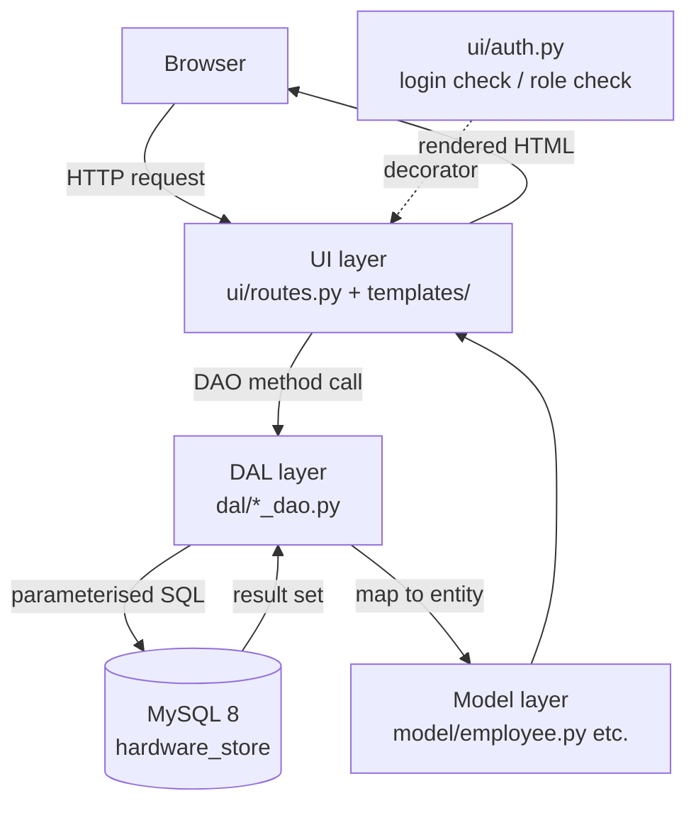

[Uploading README.md…]()
# Meítǐ Shāngchéng Administrative System

**Employee · Shift Scheduling · Inventory — one back-office for the first store in Zhengzhou**

> A custom administrative system for **Meítǐ Shāngchéng** (媒体商城), a hardware store funded by its
> parent company **Jupiter** and preparing to open its very first shop in Zhengzhou.
> It replaces the scattered *"Excel sheets + online calendars"* the company relies on today.

| Item | Details |
|---|---|
| Client | Meítǐ Shāngchéng (媒体商城), funded by parent company Jupiter |
| Client representative | Henriette (store manager) |
| Team representative | James |
| Methodology | Waterfall first, iterative later |
| Stack | Python 3 / Flask / MySQL 8 |
| Version | v1.0 — milestones M1–M6 all delivered |
| Course deliverables | Project plan, URS, test plan, test report (for another group's system), working software, Git repository |

*[中文版 / Chinese version: README.zh.md](README.zh.md)*

---

## Table of contents

- [1. Project background](#1-project-background)
- [2. Scope: deliverables & non-deliverables](#2-scope-deliverables--non-deliverables)
- [3. Feature overview](#3-feature-overview)
- [4. Requirements traceability](#4-requirements-traceability)
- [5. Roles & permission matrix](#5-roles--permission-matrix)
- [6. Technology stack](#6-technology-stack)
- [7. Quick start](#7-quick-start)
- [8. Demo accounts](#8-demo-accounts)
- [9. Directory structure](#9-directory-structure)
- [10. Architecture](#10-architecture)
- [11. Database design](#11-database-design)
- [12. Milestones & progress](#12-milestones--progress)
- [13. Testing](#13-testing)
- [14. Project documentation](#14-project-documentation)
- [15. Git collaboration workflow](#15-git-collaboration-workflow)
- [16. Known limitations & roadmap](#16-known-limitations--roadmap)
- [Appendix: one-page acceptance checklist](#appendix-one-page-acceptance-checklist)

---

## 1. Project background

### Current situation

Meítǐ Shāngchéng is a newly founded hardware store under Jupiter, currently preparing to open its
**first shop in Zhengzhou**. Management considers administration to be the backbone that runs every
aspect of the company, so they want a working system in place before the doors open.

Today, several Jupiter stores manage employees and schedules with **online calendars or Excel
sheets** — a setup that is *"too detailed and unreliable"*: data is scattered, easy to corrupt, and
impossible to review per person or per store.

### The problem

1. Employee records live in several places; there is no single entry point for hiring, changes or exits.
2. There is no quick way to search for one person, and no aggregate view (headcount, department spread).
3. Scheduling runs on Excel: you cannot view it per employee *or* per store, and shift clashes are spotted by hand.
4. Employees cannot look up their own schedule or personal data — every question goes to the administration.

### Project goal

> Let store management handle **employee records, changes, offboarding, shift planning and lookup in a
> single system**, and let employees self-service their own profile and schedule.
> If time permits, extend coverage to product stock and restock requests.

Explicitly **out of scope**: replacing management decisions. The system keeps the data correct and
visible; it does not decide for the manager.

---

## 2. Scope: deliverables & non-deliverables

### Deliverables

| Deliverable | Description |
|---|---|
| Employee management | Create, update, search, view, archive (offboard) and restore |
| Shift scheduling | Morning / Afternoon / Evening shifts; view per person and per store; clash detection |
| Employee self-service portal | Employees log in to view and adjust their own profile and see their shifts |
| Statistics overview | Headcount, department distribution, salary-range aggregates |
| Stock & restock (second priority) | Product/stock maintenance, restock request handling |
| Documentation | Project plan, URS, test plan, test report for the other group's system |
| Software & repository | A runnable web application plus this Git repository |

### Non-deliverables

The items below were mentioned by the client during the interview and are **jointly agreed to be
future versions** — they are not delivered in this project:

- Standalone department management and per-department authorisation
- In-store attendance registration and its hardware
- A management mobile app or statistics dashboard
- Payroll, finance, and data migration from Jupiter's existing ERP
- **Automatic** shift optimisation (this release does manual assignment plus clash warnings)
- Multi-store / multi-tenancy and single sign-on (SSO)

---

## 3. Feature overview

| Module | Feature | Req. ID | Milestone |
|---|---|---|---|
| Auth | Login, role-based redirect, unauthenticated interception, 403 on privilege escalation | FR-09 / NFR-03 | M2 |
| Employees | Create employee (unique employee number, field validation) | FR-01 | M3 |
| Employees | Update employee record; archived employees are locked | FR-02 | M3 |
| Employees | Archive on offboarding (soft delete, confirmation page) + restore | FR-03 | M3 |
| Employees | Active / archived dual view overview | FR-04 | M2 / M3 |
| Employees | Fuzzy search on name, employee number, position, department, email, address | FR-05 | M3 |
| Employees | Employee detail (full record + status badge) | FR-07 | M3 |
| Scheduling | Assign a shift (Morning / Afternoon / Evening) | FR-08 | M4 |
| Scheduling | Modify / cancel a shift | FR-10 | M4 |
| Scheduling | View shifts per employee | FR-11 | M4 |
| Scheduling | View the whole store's schedule (week view) | FR-12 | M4 |
| Scheduling | Clash warning when the same person gets the same shift twice on one day | FR-13 | M4 |
| Self-service | Employees view and edit their own profile | FR-14 | M5 |
| Self-service | Employees view their own upcoming shifts | FR-15 | M5 |
| Statistics | Headcount, department distribution, salary-range aggregates | FR-06 | M6 |
| Stock | Products & stock maintenance, restock request handling | FR-16 | M6 |
| Security | Audit log for key operations | FR-17 | M6 |

---

## 4. Requirements traceability

> IDs match the *User Requirements Specification (URS)*; some entries appear as `FRS-xx` in earlier
> revisions of that document. Priority follows **MoSCoW**: Must / Should / Could / Won't.

### Functional requirements

| ID | Requirement | Constraints / business rules | MoSCoW | MS | Status |
|---|---|---|---|---|---|
| FR-01 | Create an employee | Employee number required and unique (application-level check **plus** a database unique index); name required; age 16–100; salary a non-negative number; email format check; text fields ≤ 100 chars | Must | M3 | ✅ |
| FR-02 | Update an employee record | Archived employees cannot be modified — restore first | Must | M3 | ✅ |
| FR-03 | Archive / restore an employee | **Soft delete**: only `is_archived = 1`, the row is never physically removed; requires explicit confirmation (GET confirmation → POST execution) | Must | M3 | ✅ |
| FR-04 | View the employee overview | Active employees by default; `?archived=1` switches to the archived view; empty state when nothing matches | Must | M2 | ✅ |
| FR-05 | Search employees | Keyword matches name / employee number / position / department / email / address via parameterised `LIKE` | Must | M3 | ✅ |
| FR-06 | Employee statistics overview | Active headcount, department distribution, salary-range distribution | Should | M6 | ✅ |
| FR-07 | View employee detail | Full record; unknown id returns 404 | Must | M3 | ✅ |
| FR-08 | Assign a shift | Three shifts per day: Morning / Afternoon / Evening | Must | M4 | ✅ |
| FR-09 | Login authentication | Hashed password check; redirect by role after success | Must | M2 | ✅ |
| FR-10 | Modify / cancel a shift | HR administration only | Should | M4 | ✅ |
| FR-11 | View shifts per employee | Pick an employee and a date range | Must | M4 | ✅ |
| FR-12 | View the store-wide schedule | Week view — who is on duty, at a glance | Must | M4 | ✅ |
| FR-13 | Shift clash detection | One person cannot hold the same shift twice on the same day | Should | M4 | ✅ |
| FR-14 | Self-service profile maintenance | Own record only; sensitive fields (employee number, salary) are not self-editable | Must | M5 | ✅ |
| FR-15 | Self-service shift view | Own shifts only | Must | M5 | ✅ |
| FR-16 | Product & stock management (incl. restock) | Restock can be requested when stock drops below the safety threshold | Should | M6 | ✅ |
| FR-17 | Audit log | Records actor, action, target and timestamp | Could | M6 | ✅ |

### Non-functional requirements

| ID | Requirement | Where it is implemented |
|---|---|---|
| NFR-01 | List / detail respond in under 2 s with up to 1 000 rows | Indexes on `employee.is_archived` and `employee.employee_id` |
| NFR-02 | SQL-injection safe: every query parameterised (`%s` placeholders + parameter tuple); no string concatenation | `dal/*_dao.py` |
| NFR-03 | Role-based access control (RBAC) | `login_required` / `role_required` in `ui/auth.py` |
| NFR-04 | No plaintext passwords; hashing via `werkzeug` | `seed_users.py` + `ui/routes.py` |
| NFR-05 | Three-layer architecture; no SQL in the UI layer | `ui/` calls DAOs only |
| NFR-06 | Fully Chinese UI; database and connections use `utf8mb4` | `config.py` + `templates/` |
| NFR-07 | Departed employees are retained so scheduling/statistics history stays linked | Soft delete via `is_archived` |
| NFR-08 | Unauthorised write attempts return **403**, and write entries are not rendered in the UI | `role_required` + role checks in templates |

---

## 5. Roles & permission matrix

| Capability | HRAdmin | StoreManager | Employee | DepotWorker |
|---|:--:|:--:|:--:|:--:|
| View employee overview | ✅ | ✅ | — | — |
| Search / view employee detail | ✅ | ✅ | — | — |
| Create / update employees | ✅ | ❌ 403 | — | — |
| Archive / restore employees | ✅ | ❌ 403 | — | — |
| Assign / modify shifts | ✅ | ❌ 403 | — | — |
| View store-wide schedule | ✅ | ✅ | — | — |
| View statistics | ✅ | ✅ | — | — |
| View / edit **own** profile | — | — | ✅ | ✅ |
| View **own** shifts | — | — | ✅ | ✅ |
| View products & stock | ✅ | ✅ | — | ✅ |
| Raise / handle restock requests | — | ✅ | — | ✅ |

> `StoreManager` is a **read-only** role: lists and details are visible, but create / edit / archive
> buttons are never rendered. Even hand-crafting the URL hits `role_required` and returns **403**.

---

## 6. Technology stack

| Layer | Choice | Reason |
|---|---|---|
| Language | Python 3.10+ | The team already has Python and database basics from prior courses |
| Web framework | Flask | Lightweight; `Blueprint` splits the UI layer per module naturally |
| Templating | Jinja2 + hand-written CSS | No front-end framework dependency, trivial to deploy; `base.html` owns layout and theming |
| Database | MySQL 8 (`utf8mb4`) | Relational data as the client already uses; `utf8mb4` needed for Chinese text |
| Driver | PyMySQL | Pure Python, no compilation step on Windows or macOS |
| Passwords | Werkzeug `generate_password_hash` / `check_password_hash` | Ships with Flask, no extra dependency |
| Version control | Git + GitHub | Required by the course, and needed to attribute individual contribution |

---

## 7. Quick start

### 7.1 Prerequisites

- Python 3.10 or newer
- MySQL 8.0 or newer (running, reachable locally)
- Git

### 7.2 Install & run (Windows / PowerShell)

```bat
:: 1. Clone the repository
git clone <repository-url>
cd meti-shangcheng-admin

:: 2. Create and activate a virtual environment
python -m venv .venv
.venv\Scripts\activate

:: 3. Install dependencies
pip install -r requirements.txt

:: 4. Create the database, tables and demo data
mysql -u root -p < db\schema.sql

:: 5. Write real password hashes (otherwise login fails with "wrong username or password")
python seed_users.py

:: 6. Run
python app.py
```

Then open <http://127.0.0.1:5000> — you will land on the login page.

### 7.3 macOS / Linux

```bash
git clone <repository-url>
cd meti-shangcheng-admin

python3 -m venv .venv
source .venv/bin/activate

pip install -r requirements.txt
mysql -u root -p < db/schema.sql
python seed_users.py
python app.py
```

### 7.4 Troubleshooting

| Symptom | Cause & fix |
|---|---|
| "Wrong username or password" on login | The `user` table still holds placeholder passwords — run `python seed_users.py` once |
| `pymysql.err.OperationalError` | Check `DB_CONFIG` in `config.py`; make sure MySQL is running and the `hardware_store` database exists |
| Garbled Chinese characters | Confirm the schema was created with `utf8mb4` (`db/schema.sql` sets it) and do not change `charset` in the connection |
| Code changes do not show up | `DEBUG = True` auto-reloads; if not, check for an old process holding port 5000 |

---

## 8. Demo accounts

| Username | Password | Role | What they can do |
|---|---|---|---|
| `hr` | `hr123` | HRAdmin | Everything: CRUD, archiving, scheduling, statistics |
| `manager` | `manager123` | StoreManager | Read-only: lists, details, store schedule, statistics |
| `zhangsan` | `zhangsan123` | Employee | Self-service: own profile and own schedule |

> These accounts live in `INITIAL_ACCOUNTS` in `seed_users.py` and can be changed freely.
> Change them before deploying anywhere other than your own machine.

---

## 9. Directory structure

```
.
├── app.py                       # Flask entry point: create app, register blueprints, run
├── config.py                    # Global config: DB connection + Flask settings
├── requirements.txt
├── .gitignore
├── README.md
├── seed_users.py                # One-off script: replace placeholder passwords with real hashes
│
├── db/
│   └── schema.sql               # Database & tables + demo data (safe to re-run)
│
├── dal/                         # Data Access Layer — the only place SQL appears
│   ├── db.py                    #   get_connection() wrapper
│   ├── employee_dao.py          #   Employees: query / search / duplicate check / CRUD / archive
│   ├── user_dao.py              #   Accounts: lookup by username
│   ├── shift_dao.py             #   Shifts: per person / per store / clash detection
│   ├── product_dao.py           #   Products, stock and restock requests
│   └── audit_dao.py             #   Audit log write & query
│
├── model/                       # Model layer — attributes only, no business logic
│   ├── employee.py
│   ├── shift.py
│   ├── user.py
│   └── product.py
│
├── ui/                          # UI layer — interaction and presentation only, no SQL
│   ├── auth.py                  #   login_required / role_required decorators
│   ├── routes.py                #   Home, login, employee CRUD
│   ├── shift_routes.py          #   Scheduling
│   ├── selfservice_routes.py    #   Employee self-service
│   ├── stats_routes.py          #   Statistics overview
│   └── stock_routes.py          #   Stock & restock
│
├── templates/                   # Jinja2 templates
│   ├── base.html                #   Shared layout (top bar, flash messages, theming)
│   ├── login.html / home.html
│   ├── employees.html           #   List + search + active/archived switch
│   ├── employee_form.html       #   Shared create / edit form
│   ├── employee_detail.html     #   Employee detail
│   ├── employee_confirm_archive.html  # Archive confirmation page
│   ├── shifts_person.html / shifts_store.html
│   ├── profile.html             #   Employee self-service home
│   ├── stats.html
│   └── products.html / restock_requests.html
│
├── tests/                       # Automated tests
│   ├── m3_smoke_test.py         #   Employee CRUD smoke test (no MySQL needed)
│   ├── m4_shift_test.py
│   └── m5_selfservice_test.py
│
└── docs/                        # Course documentation deliverables
    ├── 01-project-plan.pdf
    ├── 02-URS.pdf
    ├── 03-test-plan.pdf
    └── 04-test-report.pdf
```

---

## 10. Architecture

A **three-layer architecture**: UI / DAL / Model. The layering rule is hard —
**no SQL is allowed in the UI layer**; every database call goes through a DAO under `dal/`.



The full path of one "create employee" request:

```
POST /employees/new
  └─ @role_required("HRAdmin")          → 403 if the role is not allowed (NFR-03 / NFR-08)
  └─ _validate_form()                  → required fields, age, salary, email, length (UI layer)
  └─ EmployeeDAO.employee_id_exists()  → duplicate employee-number check (application)
  └─ EmployeeDAO.create(Employee)      → unique index catches the rest (database)
  └─ flash success message → redirect to the list
```

**Security design**

| Measure | Implementation |
|---|---|
| SQL-injection prevention | Every statement uses `%s` placeholders with a parameter tuple — `LIKE` arguments included; nothing is concatenated |
| Password safety | `werkzeug.security` hashing and verification; no plaintext in the database |
| Privilege protection | Decorators intercept centrally; both the UI and the routes enforce it |
| Safe deletion | Offboarding is a soft delete, so shift and statistics history stays linked |
| Dangerous-action confirmation | Archiving requires a dedicated confirmation page (GET to confirm → POST to execute), not a JS popup |

---

## 11. Database design

Database: `hardware_store`, character set `utf8mb4`, collation `utf8mb4_unicode_ci`.

| Table | Purpose | Key columns & constraints |
|---|---|---|
| `user` | System accounts | `username` unique; `hashed_password`; `role` (HRAdmin / StoreManager / Employee / DepotWorker) |
| `employee` | Employee records (core table) | `employee_id` **unique** (business employee number); `is_archived` soft-delete flag, indexed; plus name, age, position, salary, department, email, contact address, emergency contact |
| `shift` | Shift schedule | `employee_id` foreign key to `employee`; `shift_date`; `shift_type` (Morning / Afternoon / Evening); unique on `(employee_id, shift_date, shift_type)` so duplicate shifts are impossible at the database level |
| `product` | Products & stock | `sku` unique; `stock_qty`; `reorder_level` safety threshold |
| `restock_request` | Restock requests | `product_id`; `qty`; `status` (pending / handled); `requested_at` |
| `audit_log` | Audit trail | `actor`; `action`; `target`; `created_at` |

Full DDL and demo data live in [`db/schema.sql`](db/schema.sql) and are safe to re-run
(demo rows are only inserted when the table is empty).

---

## 12. Milestones & progress

Milestones follow the waterfall model; each one ends in reviewable deliverables (a go / no-go point).

| Milestone | Content | Deliverable | Status |
|---|---|---|---|
| **M1** | Skeleton: repository layout, config, three-layer folders, model entities | A runnable empty application | ✅ |
| **M2** | Login authentication + role-based access control + employee overview placeholder + profile placeholder | `/login`, `/employees`, `/profile` | ✅ |
| **M3** | Employee CRUD: create / update / archive / restore / search / detail | Closed employee loop + `tests/m3_smoke_test.py` | ✅ |
| **M4** | Scheduling: per-person and per-store views; assign, modify, cancel; clash detection | Personal timetable + store week view | ✅ |
| **M5** | Employee self-service portal: view and edit own profile, view own shifts | Full `/profile` | ✅ |
| **M6** | Statistics + stock/restock + audit log + testing and delivery | Statistics page, stock module, test report | ✅ |

Course week mapping: W4 kick-off and team forming → W5 repository creation → W6 project plan and URS
finished → W7–W8 implementation and test plan → W9 final presentation.

---

## 13. Testing

### Automated tests

The repository ships a smoke test that **does not need MySQL**: real DAOs are swapped for
**in-memory fake DAOs**, so every route and template can be exercised on a machine with no database.

```bat
:: from the project root, with the venv activated
set PYTHONPATH=.
python tests\m3_smoke_test.py
```

It covers 10 scenarios and 30+ assertions:

1. Accessing a protected page while logged out → redirected to the login page
2. Wrong-password message / correct password redirects by role
3. List rendering, `?q=` search hits, and the empty state
4. Creating valid data persists it
5. Create validation: required fields, age range, numeric salary, email format, duplicate employee number
6. Detail shows all fields / unknown id returns 404
7. Update persists and the edit form is pre-filled
8. Archive confirmation page → row still exists after archiving, hidden from the active list, visible in the archived view, archived employees cannot be edited
9. Restoring puts the employee back in the active list
10. Role permissions: StoreManager is read-only; direct write-route access returns 403

### Course testing documents

| Document | Location |
|---|---|
| Test plan | `docs/03-test-plan.pdf` |
| Test report (for the other group's system) | `docs/04-test-report.pdf` |

Test cases are derived directly from the use cases in the URS: the Main Success Scenario gives the
positive cases, and the Extensions give the exception and boundary cases.

---

## 14. Project documentation

| Document | Description | Location |
|---|---|---|
| Project plan | Client, team, current situation, problem, goal, deliverables / non-deliverables, constraints, phasing | `docs/01-project-plan.pdf` |
| URS | Functional requirements (MoSCoW), non-functional requirements, use cases and use case diagram, GUI sketches and wireframes | `docs/02-URS.pdf` |
| Test plan | Test scope, strategy, cases and environment | `docs/03-test-plan.pdf` |
| Test report | Results of testing **another group's** system | `docs/04-test-report.pdf` |

---

## 15. Git collaboration workflow

The course requires every member to commit to the same repository **from their own device**; the
teacher reviews individual contribution from the commit history.

### Branches

| Branch | Purpose |
|---|---|
| `main` | Stable release; only accepts merges from feature branches |
| `feature/<milestone>-<topic>` | Feature work, e.g. `feature/M3-employee-crud` |

### Commit messages

We follow `type(scope): subject`:

```
feat(M3): employee CRUD - create/update/archive/search/detail
fix(M3): archived employee edit form did not pre-fill salary
docs(M6): add the test report
test(M3): add role permission assertions
refactor(dal): extract shared query columns
```

`type` is one of `feat` / `fix` / `docs` / `test` / `refactor` / `chore`.

### Self-check before committing

```bat
git status                       :: make sure .venv/ and __pycache__/ are not staged (.gitignore covers them)
git diff --stat                  :: confirm the change scope is what you expect
python tests\m3_smoke_test.py    :: automated tests pass
```

---

## 16. Known limitations & roadmap

### Known limitations

| Limitation | Detail | Suggestion |
|---|---|---|
| Database password hard-coded in `config.py` | Fine for a course demo, not for deployment | Read it from an environment variable and gitignore the config |
| `DEBUG = True` | Convenient in development, leaks debugging info in production | Set to `False` when deploying |
| No CSRF protection | Flask-WTF was not introduced | Add `Flask-WTF` if required |
| Lists are not paginated | Unnecessary below ~100 employees | Add pagination as data grows |
| Shifts are assigned manually | This release warns about clashes but does not optimise | See the roadmap |
| Single-machine deployment | No containerisation, no CI | Add a Dockerfile and GitHub Actions |

### Roadmap (future versions)

- **Standalone department management** — today `department` is just a text column on `employee`
- **In-store attendance registration** — check-in plus attendance statistics
- **Automatic shift suggestions** — generate a first draft from staffing demand
- **Mobile app and statistics dashboard** — management insight on the go
- **Integration with Jupiter's existing ERP**

---

## Appendix: one-page acceptance checklist

Walk through the flow below to confirm the system is complete:

1. Log in as `hr` → the employee list shows the demo data
2. Search for a position (e.g. "库管") → only the matching employee remains; search nonsense → empty state
3. Click "Add employee" → submit with only a name → red validation messages for employee number and name
4. Fill it in completely and save → the new employee appears with a success banner
5. Open "Detail" to see all fields → click "Edit", change position and salary → detail is updated
6. Click "Archive" → confirmation page → confirm → disappears from the active list; switch to "Archived" → can be restored
7. Open scheduling → give an employee a morning shift → visible both per person and in the store week view
8. Assign the same person the same shift twice on one day → clash warning appears
9. Log in as `zhangsan` → can only see and edit own profile and own shifts
10. Log in as `manager` → lists and details are visible but **no** create / edit / archive buttons;
    visiting `/employees/new` directly returns **403**

---

*Software Engineering course project · Meítǐ Shāngchéng (媒体商城) Administrative System*
