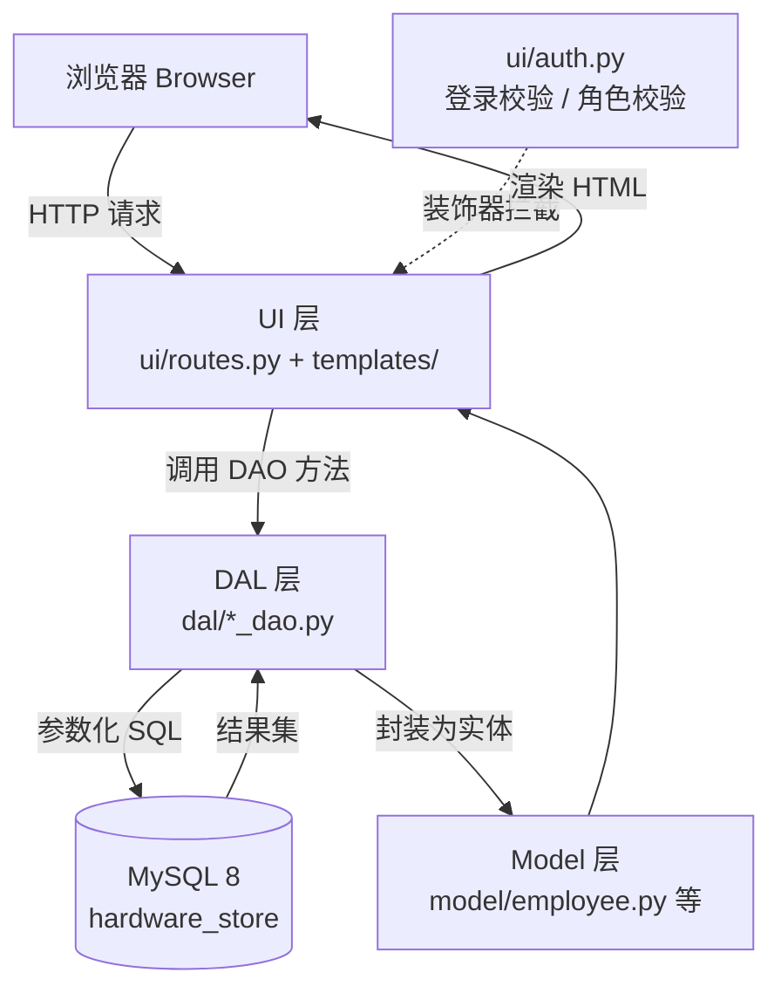

[README.md](https://github.com/user-attachments/files/33721220/README.md)
# 美体商城行政管理系统

**Meítǐ Shāngchéng Administrative System — 员工 · 排班 · 库存一体化后台**

> 为「美体商城」（Meítǐ Shāngchéng）郑州首店定制的行政管理系统。
> 母公司 Jupiter 出资，门店管理层希望通过一套系统把**员工档案、排班、库存**管起来，
> 替代目前「Excel + 在线日历」这种过于零散、不可靠的做法。

| 项目 | 内容 |
|---|---|
| 客户 | 美体商城（Meítǐ Shāngchéng），母公司 Jupiter |
| 客户代表 | Henriette（门店经理） |
| 团队代表 | James |
| 开发方法 | 瀑布模型（Waterfall）+ 后期迭代（Iterative） |
| 开发语言 | Python 3 / Flask / MySQL 8 |
| 当前版本 | v1.0（M1–M6 全部里程碑已完成） |
| 课程交付物 | 项目计划、URS、测试计划、测试报告、可运行软件、Git 仓库 |

---

## 目录

- [1. 项目背景](#1-项目背景)
- [2. 交付范围与非交付范围](#2-交付范围与非交付范围)
- [3. 功能总览](#3-功能总览)
- [4. 需求对照表](#4-需求对照表)
- [5. 角色与权限矩阵](#5-角色与权限矩阵)
- [6. 技术选型](#6-技术选型)
- [7. 快速开始](#7-快速开始)
- [8. 演示账号](#8-演示账号)
- [9. 目录结构](#9-目录结构)
- [10. 架构设计](#10-架构设计)
- [11. 数据库设计](#11-数据库设计)
- [12. 里程碑与进度](#12-里程碑与进度)
- [13. 测试](#13-测试)
- [14. 项目文档](#14-项目文档)
- [15. Git 协作规范](#15-git-协作规范)
- [16. 已知限制与后续规划](#16-已知限制与后续规划)

---

## 1. 项目背景

### 客户现状

美体商城是 Jupiter 旗下新开的五金门店，正在郑州筹备**第一家门店**。公司管理层认为，行政（administration）是支撑整个公司运转的骨干，因此希望在开业前就有一套可用的行政系统。

目前 Jupiter 旗下部分门店使用**在线日历或 Excel 表格**管理员工与排班，问题是「太细碎、不可靠」——数据分散、容易出错、无法按人/按店统一查看。

### 要解决的问题

1. 员工档案散落各处，入职、离职、信息变更没有统一入口；
2. 无法快速检索某个员工，也无法看到门店层面的聚合情况（有多少人、各部门分布等）；
3. 排班靠 Excel，既不能按人查，也不能按门店整体查，早晚班冲突靠人肉发现；
4. 员工本人无法自助查看自己的排班和个人资料，所有事情都要问行政。

### 项目目标

> 让门店管理层在**一个系统里**完成员工建档、变更、离职归档、排班分配与查询，
> 并让员工本人可以自助查看与维护自己的资料和排班；
> 在时间允许的前提下，进一步覆盖商品库存与补货请求。

**明确不做**的是「用系统替代管理决策」，系统只负责把数据管对、管清楚。

---

## 2. 交付范围与非交付范围

### Deliverables（我们交付什么）

| 交付物 | 说明 |
|---|---|
| 员工管理模块 | 建档、修改、检索、详情、离职归档与恢复 |
| 排班管理模块 | 早 / 中 / 晚三班分配，按人查看、按门店查看，冲突检测 |
| 员工自助门户 | 员工登录后查看并修改个人资料、查看本人排班 |
| 统计概览 | 在职人数、部门分布、薪资区间等聚合视图 |
| 库存与补货（次优先） | 商品 / 库存维护，补货请求提交与处理 |
| 文档 | 项目计划（Project Plan）、URS、测试计划、对他组系统的测试报告 |
| 软件与仓库 | 可运行的 Web 应用 + 本 Git 仓库 |

### Non-deliverables（我们不交付什么）

以下属于客户在访谈中提到、但双方确认**放到未来版本**的内容，本合同期内不交付：

- 部门（Department）的独立管理与按部门分权
- 门店考勤打卡（attendance registration）及配套硬件
- 管理端移动 App、数据统计大屏
- 财务与工资发放、与 Jupiter 现有 ERP 的数据迁移
- 排班的**自动**优化算法（本期只做手动分配 + 冲突提示）
- 多门店 / 多租户、单点登录（SSO）

---

## 3. 功能总览

| 模块 | 功能 | 需求编号 | 里程碑 |
|---|---|---|---|
| 登录与权限 | 账号密码登录、按角色跳转、未登录拦截、越权 403 | FR-09 / NFR-03 | M2 |
| 员工管理 | 新增员工（工号唯一、字段校验） | FR-01 | M3 |
| 员工管理 | 修改员工档案；已归档员工禁止修改 | FR-02 | M3 |
| 员工管理 | 离职归档（软删除，二次确认页）+ 恢复 | FR-03 | M3 |
| 员工管理 | 在职 / 已归档双视图总览 | FR-04 | M2 / M3 |
| 员工管理 | 按姓名、工号、岗位、部门、邮箱、地址模糊检索 | FR-05 | M3 |
| 员工管理 | 员工详情（完整档案 + 在职状态标签） | FR-07 | M3 |
| 排班管理 | 给员工排班（Morning / Afternoon / Evening） | FR-08 | M4 |
| 排班管理 | 修改 / 撤销排班 | FR-10 | M4 |
| 排班管理 | 按员工查看排班（个人班表） | FR-11 | M4 |
| 排班管理 | 按门店查看全店排班（周视图） | FR-12 | M4 |
| 排班管理 | 同一人同一天同一班次重复时给出冲突提示 | FR-13 | M4 |
| 员工自助 | 员工查看并修改自己的个人资料 | FR-14 | M5 |
| 员工自助 | 员工查看自己未来的排班 | FR-15 | M5 |
| 统计 | 在职人数、部门分布、薪资区间聚合统计 | FR-06 | M6 |
| 库存 | 商品与库存维护、补货请求提交与处理 | FR-16 | M6 |
| 安全 | 关键操作写入审计日志 | FR-17 | M6 |

---

## 4. 需求对照表

> 编号与《User Requirements Specification（URS）》保持一致（URS 早期版本中部分编号写作 `FRS-xx`）。
> 优先级按 **MoSCoW** 划分：Must / Should / Could / Won't。

### 功能性需求（Functional Requirements）

| 编号 | 需求 | 约束 / 业务规则 | MoSCoW | 里程碑 | 状态 |
|---|---|---|---|---|---|
| FR-01 | 新增员工 | 工号必填且唯一（应用层查重 + 数据库唯一索引双保险）；姓名必填；年龄 16–100；薪资非负数字；邮箱格式校验；文本字段 ≤100 字符 | Must | M3 | ✅ |
| FR-02 | 修改员工档案 | 已归档员工不可修改，需先恢复 | Must | M3 | ✅ |
| FR-03 | 归档离职员工 / 恢复 | **软删除**：仅置 `is_archived = 1`，记录不物理删除；必须经显式确认页（GET 确认 / POST 执行） | Must | M3 | ✅ |
| FR-04 | 查看员工总览 | 默认只看在职；`?archived=1` 切换已归档视图；无结果时显示空态 | Must | M2 | ✅ |
| FR-05 | 检索员工 | 关键词对姓名 / 工号 / 岗位 / 部门 / 邮箱 / 地址模糊匹配，参数化 `LIKE` | Must | M3 | ✅ |
| FR-06 | 员工统计概览 | 在职人数、部门分布、薪资区间分布 | Should | M6 | ✅ |
| FR-07 | 查看员工详情 | 展示完整档案；记录不存在返回 404 | Must | M3 | ✅ |
| FR-08 | 分配排班 | 一天三段：Morning / Afternoon / Evening | Must | M4 | ✅ |
| FR-09 | 登录认证 | 密码哈希校验；成功后按角色跳转 | Must | M2 | ✅ |
| FR-10 | 修改 / 撤销排班 | 仅 HR 行政可操作 | Should | M4 | ✅ |
| FR-11 | 按员工查看排班 | 支持选择员工 + 时间范围 | Must | M4 | ✅ |
| FR-12 | 按门店查看排班 | 全店周视图，一眼看到每天都谁在岗 | Must | M4 | ✅ |
| FR-13 | 排班冲突检测 | 同一员工同一天同一班次不可重复 | Should | M4 | ✅ |
| FR-14 | 员工自助维护个人资料 | 只能改自己的；敏感字段（工号、薪资）不可自助修改 | Must | M5 | ✅ |
| FR-15 | 员工自助查看排班 | 只能看自己的 | Must | M5 | ✅ |
| FR-16 | 商品与库存管理（含补货请求） | 库存低于安全阈值时可发起补货请求 | Should | M6 | ✅ |
| FR-17 | 操作审计日志 | 记录操作人、动作、对象、时间 | Could | M6 | ✅ |

### 非功能性需求（Non-Functional Requirements）

| 编号 | 需求 | 落实位置 |
|---|---|---|
| NFR-01 | 1000 条数据内，列表 / 详情响应时间 < 2s | `employee` 表 `is_archived`、`employee_id` 建索引 |
| NFR-02 | 防 SQL 注入：全部查询参数化（`%s` 占位 + 参数元组），禁止字符串拼接 | `dal/*_dao.py` |
| NFR-03 | 基于角色的访问控制（RBAC） | `ui/auth.py` 的 `login_required` / `role_required` |
| NFR-04 | 密码不得以明文存储，使用 `werkzeug` 哈希 | `seed_users.py` + `ui/routes.py` |
| NFR-05 | 三层架构，UI 层不出现任何 SQL | `ui/` 只调 DAO，不写 SQL |
| NFR-06 | 全中文界面，数据库与连接统一 `utf8mb4` | `config.py` + `templates/` |
| NFR-07 | 离职员工数据保留，排班 / 统计等历史数据不断链 | 软删除 `is_archived` |
| NFR-08 | 无权限执行写操作时返回 403，且界面不渲染写操作入口 | `role_required` + 模板按角色判断 |

---

## 5. 角色与权限矩阵

| 能力 | HRAdmin（行政） | StoreManager（门店经理） | Employee（员工） | DepotWorker（仓库） |
|---|:--:|:--:|:--:|:--:|
| 查看员工总览 | ✅ | ✅ | — | — |
| 检索 / 查看员工详情 | ✅ | ✅ | — | — |
| 新增 / 修改员工 | ✅ | ❌ 403 | — | — |
| 归档 / 恢复员工 | ✅ | ❌ 403 | — | — |
| 分配 / 修改排班 | ✅ | ❌ 403 | — | — |
| 查看全店排班 | ✅ | ✅ | — | — |
| 查看统计概览 | ✅ | ✅ | — | — |
| 查看 / 修改**本人**资料 | — | — | ✅ | ✅ |
| 查看**本人**排班 | — | — | ✅ | ✅ |
| 查看商品与库存 | ✅ | ✅ | — | ✅ |
| 提交 / 处理补货请求 | — | ✅ | — | ✅ |

> `StoreManager` 是**只读**角色：列表与详情可看，但界面上不出现新增 / 编辑 / 归档按钮；
> 即使直接构造 URL 访问写路由，也会被 `role_required` 拦下并返回 **403**。

---

## 6. 技术选型

| 层次 | 选型 | 理由 |
|---|---|---|
| 语言 | Python 3.10+ | 团队已具备 Python 与数据库基础，课程先修内容可直接复用 |
| Web 框架 | Flask | 轻量、蓝图（`Blueprint`）天然支持按模块拆分 UI 层 |
| 模板 | Jinja2 + 手写 CSS | 无前端框架依赖，部署简单；`base.html` 统一布局与配色 |
| 数据库 | MySQL 8（`utf8mb4`） | 客户既有关系型数据，中文存储需要 `utf8mb4` |
| 驱动 | PyMySQL | 纯 Python 实现，Windows / macOS 免编译 |
| 密码 | Werkzeug `generate_password_hash` / `check_password_hash` | Flask 自带，无需额外依赖 |
| 版本控制 | Git + GitHub | 课程明确要求，且需要按人统计贡献 |

---

## 7. 快速开始

### 7.1 环境要求

- Python 3.10 及以上
- MySQL 8.0 及以上（确保已启动，且能本地连接）
- Git

### 7.2 安装与启动（Windows / PowerShell）

```bat
:: 1. 克隆仓库
git clone <仓库地址>
cd meti-shangcheng-admin

:: 2. 创建并激活虚拟环境
python -m venv .venv
.venv\Scripts\activate

:: 3. 安装依赖
pip install -r requirements.txt

:: 4. 建库建表 + 写入演示数据
mysql -u root -p < db\schema.sql

:: 5. 生成真实密码哈希（否则登录会提示「用户名或密码错误」）
python seed_users.py

:: 6. 启动
python app.py
```

浏览器打开 <http://127.0.0.1:5000>，会自动跳转到登录页。

### 7.3 macOS / Linux

```bash
git clone <仓库地址>
cd meti-shangcheng-admin

python3 -m venv .venv
source .venv/bin/activate

pip install -r requirements.txt
mysql -u root -p < db/schema.sql
python seed_users.py
python app.py
```

### 7.4 常见问题

| 现象 | 原因与处理 |
|---|---|
| 登录提示「用户名或密码错误」 | `user` 表里还是占位密码，先跑一次 `python seed_users.py` |
| `pymysql.err.OperationalError` 连不上库 | 检查 `config.py` 的 `DB_CONFIG`，确认 MySQL 已启动、库 `hardware_store` 已建 |
| 中文乱码 | 确认建库用了 `utf8mb4`（`db/schema.sql` 已指定），连接串 `charset` 不要改 |
| 修改了代码但页面没变 | 开发模式 `DEBUG = True` 会自动重载；若手动启动过一次请确认没有旧进程占用 5000 端口 |

---

## 8. 演示账号

| 用户名 | 密码 | 角色 | 能做什么 |
|---|---|---|---|
| `hr` | `hr123` | HRAdmin | 全部功能：增删改、归档、排班、统计 |
| `manager` | `manager123` | StoreManager | 只读：看列表、详情、全店排班、统计 |
| `zhangsan` | `zhangsan123` | Employee | 自助：改自己的资料、看自己的排班 |

> 这些账号写在 `seed_users.py` 的 `INITIAL_ACCOUNTS` 里，可自行增删。
> 部署到任何非本机环境前请务必修改。

---

## 9. 目录结构

```
.
├── app.py                       # Flask 入口：创建应用、注册蓝图、启动服务
├── config.py                    # 全局配置：数据库连接 + Flask 设置
├── requirements.txt             # 依赖清单
├── .gitignore
├── README.md
├── seed_users.py                # 一次性脚本：把占位密码替换为真实哈希
│
├── db/
│   └── schema.sql               # 建库建表 + 演示数据（可重复执行）
│
├── dal/                         # DAL 数据访问层：只有这里出现 SQL
│   ├── db.py                    #   数据库连接封装 get_connection()
│   ├── employee_dao.py          #   员工：查询 / 检索 / 查重 / 增 / 改 / 归档
│   ├── user_dao.py              #   账号：按用户名查询
│   ├── shift_dao.py             #   排班：按人 / 按店 / 冲突检测
│   ├── product_dao.py           #   商品与库存、补货请求
│   └── audit_dao.py             #   审计日志写入与查询
│
├── model/                       # Model 层：只放属性，不写业务逻辑
│   ├── employee.py
│   ├── shift.py
│   ├── user.py
│   └── product.py
│
├── ui/                          # UI 层：只负责交互与展示，不写 SQL
│   ├── auth.py                  #   login_required / role_required 装饰器
│   ├── routes.py                #   首页、登录、员工 CRUD
│   ├── shift_routes.py          #   排班
│   ├── selfservice_routes.py    #   员工自助
│   ├── stats_routes.py          #   统计概览
│   └── stock_routes.py          #   库存与补货
│
├── templates/                   # Jinja2 模板
│   ├── base.html                #   统一布局（顶栏、Flash 提示、配色）
│   ├── login.html / home.html
│   ├── employees.html           #   列表 + 检索 + 在职/已归档切换
│   ├── employee_form.html       #   新增 / 编辑共用表单
│   ├── employee_detail.html     #   员工详情
│   ├── employee_confirm_archive.html  # 归档二次确认页
│   ├── shifts_person.html / shifts_store.html
│   ├── profile.html             #   员工自助主页
│   ├── stats.html
│   └── products.html / restock_requests.html
│
├── tests/                       # 自动化测试
│   ├── m3_smoke_test.py         #   员工 CRUD 冒烟测试（不依赖 MySQL）
│   ├── m4_shift_test.py
│   └── m5_selfservice_test.py
│
└── docs/                        # 课程文档交付物
    ├── 01-project-plan.pdf
    ├── 02-URS.pdf
    ├── 03-test-plan.pdf
    └── 04-test-report.pdf
```

---

## 10. 架构设计

采用**三层架构**：UI / DAL / Model。分层约束是硬性要求——
**UI 层不允许出现任何 SQL**，所有数据库访问必须走 `dal/` 下的 DAO。



一次「新增员工」请求的完整链路：

```
POST /employees/new
  └─ @role_required("HRAdmin")      越权直接 403（NFR-03 / NFR-08）
  └─ _validate_form()               必填、年龄、薪资、邮箱、长度（UI 层职责）
  └─ EmployeeDAO.employee_id_exists()  工号查重（应用层）
  └─ EmployeeDAO.create(Employee)   唯一索引兜底（数据库层）
  └─ flash 成功提示 → 重定向列表页
```

**安全设计**

| 措施 | 实现 |
|---|---|
| 防 SQL 注入 | 所有 SQL 一律 `%s` 占位 + 参数元组，`LIKE` 的参数也在元组里，不做字符串拼接 |
| 密码安全 | `werkzeug.security` 哈希存储与校验，库中无明文 |
| 越权防护 | 装饰器统一拦截，界面与路由双层控制 |
| 删除安全 | 离职走软删除，历史排班 / 统计数据不断链 |
| 危险操作确认 | 归档必须经独立确认页（GET 确认 → POST 执行），不是 JS 弹窗 |

---

## 11. 数据库设计

数据库：`hardware_store`，字符集 `utf8mb4` / 排序规则 `utf8mb4_unicode_ci`。

| 表 | 作用 | 关键字段与约束 |
|---|---|---|
| `user` | 系统账号 | `username` 唯一；`hashed_password`；`role`（HRAdmin / StoreManager / Employee / DepotWorker） |
| `employee` | 员工档案（核心表） | `employee_id` **唯一**（业务工号）；`is_archived` 软删除标志并建索引；含姓名、年龄、岗位、薪资、部门、邮箱、联系地址、紧急联系人 |
| `shift` | 排班 | `employee_id` 外键关联 `employee`；`shift_date`；`shift_type`（Morning / Afternoon / Evening）；`(employee_id, shift_date, shift_type)` 唯一，从数据库层杜绝重复排班 |
| `product` | 商品与库存 | `sku` 唯一；`stock_qty`；`reorder_level` 安全库存阈值 |
| `restock_request` | 补货请求 | `product_id`；`qty`；`status`（待处理 / 已处理）；`requested_at` |
| `audit_log` | 审计日志 | `actor`；`action`；`target`；`created_at` |

完整的建表语句与演示数据见 [`db/schema.sql`](db/schema.sql)，可重复执行（演示数据只在表为空时插入）。

---

## 12. 里程碑与进度

按瀑布模型划分，每个里程碑以可评审的交付物结束（go / no-go 决策点）。

| 里程碑 | 内容 | 交付物 | 状态 |
|---|---|---|---|
| **M1** | 项目骨架：仓库结构、配置、三层目录、Model 层实体 | 可启动的空壳应用 | ✅ |
| **M2** | 登录认证 + 基于角色的访问控制 + 员工总览占位 + 个人主页占位 | `/login`、`/employees`、`/profile` | ✅ |
| **M3** | 员工增删改查：新增 / 修改 / 软归档 / 恢复 / 检索 / 详情 | 员工管理闭环 + `tests/m3_smoke_test.py` | ✅ |
| **M4** | 排班管理：按人、按门店查看；分配、修改、撤销；冲突检测 | 个人班表 + 全店周视图 | ✅ |
| **M5** | 员工自助门户：查看并修改个人资料、查看本人排班 | `/profile` 完整版 | ✅ |
| **M6** | 统计概览 + 库存与补货 + 审计日志 + 测试与交付 | 统计页、库存模块、测试报告 | ✅ |

课程周计划对应：W4 立项与组队 → W5 建仓库 → W6 完成项目计划与 URS → W7–W8 实现与测试计划 → W9 终版演示。

---

## 13. 测试

### 自动化测试

仓库提供不依赖 MySQL 的冒烟测试——用**内存假 DAO**替换真实 DAO，
可以在没装数据库的机器上跑通全部路由与模板。

```bat
:: 项目根目录、已激活 venv
set PYTHONPATH=.
python tests\m3_smoke_test.py
```

覆盖 10 组场景、30+ 项断言：

1. 未登录访问受保护页面 → 跳转登录页
2. 错误密码提示 / 正确密码按角色跳转
3. 列表渲染、`?q=` 检索命中与空态
4. 新增合法数据落库
5. 新增校验：必填、年龄范围、薪资数字、邮箱格式、工号重复
6. 详情字段齐全 / 不存在返回 404
7. 修改落库与编辑页回填
8. 归档确认页 → 软归档后记录仍在、在职列表隐藏、已归档视图可见、已归档不可编辑
9. 恢复后重新出现在在职列表
10. 角色权限：StoreManager 只读，直接访问写路由返回 403

### 课程交付的测试文档

| 文档 | 位置 |
|---|---|
| 测试计划（Test Plan） | `docs/03-test-plan.pdf` |
| 测试报告（对他组系统的测试） | `docs/04-test-report.pdf` |

测试用例直接由 URS 中的用例（Use Case）导出：主成功场景（MSS）对应正向用例，扩展（Extension）对应异常与边界用例。

---

## 14. 项目文档

| 文档 | 说明 | 位置 |
|---|---|---|
| Project Plan（项目计划） | 客户、团队、现状、问题、目标、交付 / 非交付、约束、阶段划分 | `docs/01-project-plan.pdf` |
| URS（用户需求规格） | 功能需求（MoSCoW）、非功能需求、用例与用例图、GUI 草图与线框图 | `docs/02-URS.pdf` |
| Test Plan（测试计划） | 测试范围、策略、用例与环境 | `docs/03-test-plan.pdf` |
| Test Report（测试报告） | 对**另一组**系统的测试执行结果 | `docs/04-test-report.pdf` |

---

## 15. Git 协作规范

课程要求每位成员**在自己的设备上**向同一仓库提交，教师通过提交记录评估个人贡献。

### 分支

| 分支 | 用途 |
|---|---|
| `main` | 稳定版本，只接受来自功能分支的合并 |
| `feature/<milestone>-<topic>` | 功能开发，如 `feature/M3-employee-crud` |

### 提交信息

采用 `type(scope): subject` 约定：

```
feat(M3): 员工增删改查 —— 新增/修改/软归档/检索/详情
fix(M3): 已归档员工编辑页未回填薪资
docs(M6): 补充测试报告
test(M3): 增加角色权限断言
refactor(dal): 抽出公共查询字段
```

`type` 取值：`feat` / `fix` / `docs` / `test` / `refactor` / `chore`。

### 提交前自检

```bat
git status          :: 确认 .venv/、__pycache__/ 没被带进去（.gitignore 已覆盖）
git diff --stat     :: 确认改动范围符合预期
python tests\m3_smoke_test.py   :: 自动化测试通过
```

---

## 16. 已知限制与后续规划

### 已知限制

| 限制 | 说明 | 建议 |
|---|---|---|
| 数据库口令写死在 `config.py` | 当前为课程演示配置 | 改为读取环境变量，并将 `config.py` 加入 `.gitignore` |
| `DEBUG = True` | 开发期方便，生产环境会泄露调试信息 | 部署时置为 `False` |
| 未启用 CSRF 防护 | 未引入 Flask-WTF | 需要时接入 `Flask-WTF` |
| 列表未分页 | 员工数 < 100 时无必要 | 数据量增长后加分页 |
| 排班为手动分配 | 本期只做冲突提示，不做自动优化 | 见后续规划 |
| 单机部署 | 无容器化、无 CI | 可加 Dockerfile 与 GitHub Actions |

### 后续规划（未来版本）

- **部门（Department）独立管理**：目前 `department` 只是员工表上的一个文本字段
- **门店考勤打卡**：到岗登记与出勤统计
- **排班自动推荐**：按人力与班次需求自动生成初版班表
- **移动端与统计大屏**：管理层随时查看经营与人力数据
- **与 Jupiter 现有 ERP 集成**

---

## 附：一页纸验收清单

跑一遍下面的流程，即可确认系统完整可用：

1. 用 `hr` 登录 → 进入员工列表，看到演示数据
2. 搜索框输入「库管」→ 只剩对应员工；输入不存在的关键字 → 空态提示
3. 点「新增员工」→ 只填姓名就提交 → 看到工号 / 姓名必填的红字提示
4. 填完整保存 → 列表出现新员工 + 顶部成功提示
5. 点「详情」看全字段 → 点「编辑」改岗位和薪资 → 保存后详情已更新
6. 点「归档」→ 确认页 → 确认 → 在职列表消失；切「已归档」→ 可恢复
7. 进入排班 → 给某员工排早班 → 按人查看、按门店周视图查看均能看到
8. 重复排同一人同一天同一班次 → 出现冲突提示
9. 换 `zhangsan` 登录 → 只能看自己的资料和排班
10. 换 `manager` 登录 → 能看列表与详情，但**没有**新增 / 编辑 / 归档按钮；
    直接访问 `/employees/new` → **403**

---

*软件工程课程项目 · 美体商城（Meítǐ Shāngchéng）行政管理系统*
